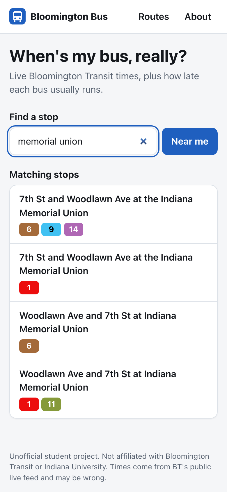
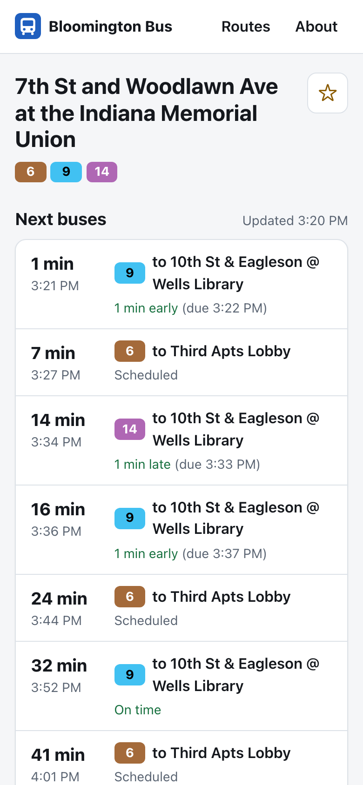
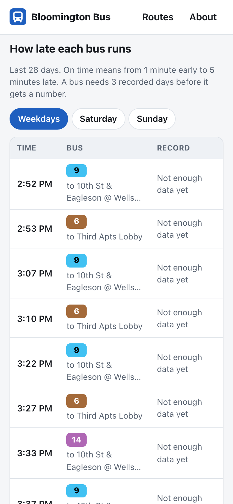
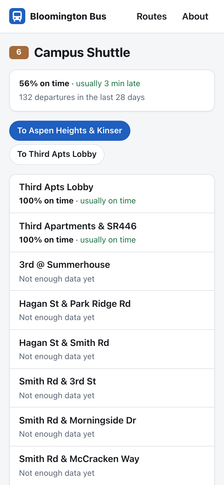
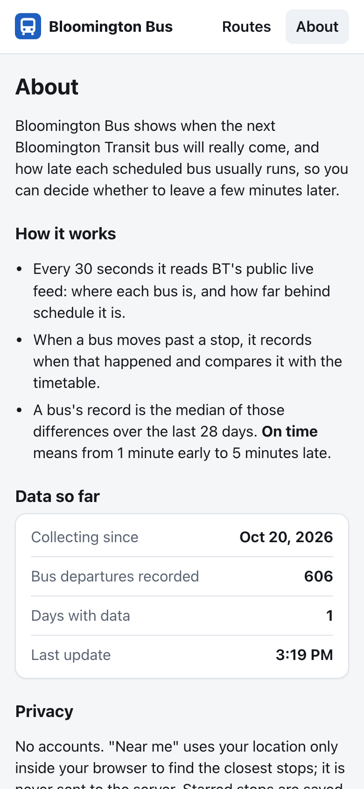

# Bloomington Bus

[](https://github.com/Akshar106/bloomington-bus/actions/workflows/ci.yml)

**When is the next Bloomington Transit bus really coming, and how late does it usually run?**

A small web app for IU students. It shows live arrivals at any Bloomington Transit (BT) stop and the track record of every scheduled bus ("the 8:10 AM Route 6 at Wells Library is usually 3 minutes late, on time 70% of weekdays"), built from data it collects itself.

**Live demo: [bloomington-bus.onrender.com](https://bloomington-bus.onrender.com)**. It runs on Render's free tier, which sleeps when nobody is using it, so the first visit can take about a minute to wake up.

> Unofficial student project. Not affiliated with Bloomington Transit or Indiana University.

## Screenshots

Taken on Oct 20, 2026 from the app running locally against BT's live feed, on its first afternoon of collecting data. The live times are real. A bus needs 3 recorded days before it gets a track record, so the stop's table still says "Not enough data yet", and the route page reflects only a few hours.

<table>
  <tr>
    <td align="center"><br><sub><b>Find a stop</b> by name or "Near me"</sub></td>
    <td align="center"><br><sub><b>Next buses</b>, live from BT's feed</sub></td>
    <td align="center"><br><sub><b>How late each bus runs</b> (fills in after 3 days)</sub></td>
  </tr>
  <tr>
    <td align="center"><br><sub><b>Route page</b> with each stop's record</sub></td>
    <td align="center"><br><sub><b>About</b>, with live collection stats</sub></td>
    <td></td>
  </tr>
</table>

## What it does

- **Find a stop** by name, or tap **Near me**. Your location is used only in your browser.
- **Next buses** at a stop, refreshed every 30 seconds, adjusted by BT's live feed.
- **How late each bus runs:** every scheduled departure on weekdays, Saturdays or Sundays with its median delay and on-time rate over the last 28 days. On time means from 1 minute early to 5 minutes late.
- **Route pages** with each stop's record, and **starred stops** saved in the browser (no accounts).

## How it works

```
BT schedule (gtfs.zip) ──import──▶ SQLite ◀──departures── collector (every 30 s)
BT live feed (trip updates + vehicle positions) ────────────────┘   │
                                                                     ▼
                          React app ◀──JSON── Express API (same Node process)
```

BT publishes its schedule and a GTFS-Realtime feed through its vendor, ETA Transit Systems. Both are free and need no key. Recording a few snapshots showed what the live feed contains:

- **Trip updates** list each bus's *upcoming* stops with one trip-wide delay, in whole minutes, and no absolute times or stop IDs. Everything is joined to the schedule by trip and stop sequence.
- **Vehicle positions** name the stop each bus is heading to. They run about 30 seconds ahead of the trip updates.
- Some buses stay attached to long-finished trips with hours of "delay". Anything over an hour is ignored.

The collector compares consecutive snapshots. When a bus's position moves past a stop, the bus left that stop in the last 30 seconds. The collector records when, placing it inside that window using the earlier prediction, and stores it next to the scheduled time. Gaps longer than 3 minutes, such as a laptop asleep, are skipped rather than guessed. See [`server/src/collector/infer.ts`](server/src/collector/infer.ts).

## Tech

| Part | Tools |
|---|---|
| Frontend | React, TypeScript, Vite, React Router, CSS Modules |
| Backend | Node.js 24+ (runs TypeScript directly), Express, SQLite (`better-sqlite3`), `gtfs-realtime-bindings` |
| Tests | Vitest: time-zone math including DST, detection rules, a replay of real recorded feed snapshots, API |
| Hosting | Render free tier, for test deploys |

## Run it locally

Requires Node.js 24 or newer.

```bash
npm install
npm run import-schedule      # downloads BT's schedule into data/bus.sqlite
scripts/collector.sh start   # collects departures in the background (stop | status)
npm run dev:server           # API on http://localhost:3000
npm run dev:client           # app on http://localhost:5173
```

If those ports are taken, run `PORT=3200 npm run dev:server` and `API_URL=http://localhost:3200 npm run dev:client -- --port 5180`.

Checks: `npm test`, `npm run typecheck`, `npm run lint`. Production mode is `npm run build && npm start` (one server on port 3000).

On macOS, the collector script also keeps the laptop from idle-sleeping while it runs. Closing the lid still sleeps it, and that shows up as a gap in the data.

## CI/CD

[`.github/workflows/ci.yml`](.github/workflows/ci.yml) runs on every push and pull request:

1. **Checks:** type-check, lint, unit and API tests, production build (Node 24, like Render).
2. **Deploy** (pushes to `main` only, after the checks pass): calls the Render service's deploy hook, waits until `/api/status` reports the pushed commit, then smoke-tests the live site.

Render's own deploy-on-push is off in [`render.yaml`](render.yaml), so a commit that fails CI never goes live. Until Render is connected, the deploy job passes with a notice instead of deploying.

## Deploy on Render (free)

Render's free web services sleep after 15 minutes without visitors and reset their disk on restart. So a deploy can ship a snapshot of the history collected on your laptop, and it keeps collecting while awake.

One-time setup:

1. On [render.com](https://render.com), sign in with GitHub, choose **New → Blueprint** and pick this repo. [`render.yaml`](render.yaml) creates the free web service and its first deploy.
2. In the service's **Settings → Deploy Hook**, copy the URL. Then save it, and the site's URL, in GitHub:
   ```bash
   gh secret set RENDER_DEPLOY_HOOK_URL
   gh variable set RENDER_SITE_URL --body https://<your-service>.onrender.com
   ```
3. From then on, every green push to `main` deploys automatically.

To ship history: run `npm run snapshot` (writes `data/snapshot/bus.sqlite.gz`, the last 28 days), commit it and push. When the test is over, delete the service in Render's dashboard and remove the secret with `gh secret delete RENDER_DEPLOY_HOOK_URL`.

## Project layout

```text
client/   React app (pages, components, formatting and search helpers)
server/   API, schedule import, live-feed reader, collector, tests and fixtures
scripts/  collector.sh: run the collector in the background
data/     the SQLite database (git-ignored)
```

## Data and license

Schedule and live data come from Bloomington Transit's public GTFS and GTFS-Realtime feeds. The code is MIT licensed.
